<div align="center">



<br/>

<a href="https://github.com/wewen06">
  
</a>

<br/><br/>

<a href="https://github.com/wewen06"></a>
<a href="https://www.linkedin.com/in/USERNAME-KAMU"></a>
<a href="mailto:EMAIL-KAMU@gmail.com"></a>
<a href="https://instagram.com/USERNAME-KAMU"></a>


</div>

<br/>

## About

<table>
  <tr>
    <td width="60%" valign="top">

Mahasiswa yang berfokus pada pengembangan web. Saya menyukai antarmuka yang rapi, kode yang mudah dibaca, dan proyek kecil yang benar-benar berfungsi.

- Berfokus pada frontend, dengan pengalaman backend menggunakan PHP
- Sedang memperdalam React dan konsep OOP
- Terbuka untuk kolaborasi dan diskusi teknis

    </td>
    <td width="40%" valign="top">

```js
const wendy = {
  name: "Wendy Virtus",
  focus: ["Web", "Frontend"],
  learning: ["React", "OOP"],
  motto: "Build. Learn. Repeat.",
};
```

    </td>
  </tr>
</table>

<br/>

## Tech Stack

<div align="center">


</div>

<br/>

## Featured Projects

<table>
  <tr>
    <td width="50%" valign="top">
      <h4><a href="https://github.com/wewen06/Portfolio-Website">Portfolio-Website</a></h4>
      Portofolio pribadi berisi info akademik, mata kuliah unggulan, dan proyek.<br/><br/>
      <code>HTML</code>
    </td>
    <td width="50%" valign="top">
      <h4><a href="https://github.com/wewen06/Calculator-Project">Calculator-Project</a></h4>
      Kalkulator modern dengan mode terang/gelap, input keyboard, dan animasi halus.<br/><br/>
      <code>JavaScript</code> <code>CSS</code>
    </td>
  </tr>
  <tr>
    <td width="50%" valign="top">
      <h4><a href="https://github.com/wewen06/Quiz-Project">Quiz-Project</a></h4>
      Aplikasi kuis berbahasa Indonesia dengan timer, bonus kecepatan, streak, dan penjelasan jawaban.<br/><br/>
      <code>React</code> <code>HTML</code>
    </td>
    <td width="50%" valign="top">
      <h4><a href="https://github.com/wewen06/CodingCamp-RevoU">CodingCamp-RevoU</a></h4>
      Mini project dari program coding camp RevoU.<br/><br/>
      <code>CSS</code>
    </td>
  </tr>
  <tr>
    <td width="50%" valign="top">
      <h4><a href="https://github.com/wewen06/OOP-Assignment">OOP-Assignment</a></h4>
      Latihan konsep Object-Oriented Programming.<br/><br/>
      <code>PHP</code>
    </td>
    <td width="50%" valign="top">
      <h4><a href="https://github.com/wewen06/Wendy-Virtus_H1H024048_ResponsiPBO25">ResponsiPBO25</a></h4>
      Tugas responsi Pemrograman Berorientasi Objek.<br/><br/>
      <code>PHP</code>
    </td>
  </tr>
</table>

<br/>

## GitHub Statistics

<div align="center">


<br/>


</div>

<br/>

## Activity

<div align="center">


<br/><br/>

<picture>
  <source media="(prefers-color-scheme: dark)" srcset="https://raw.githubusercontent.com/wewen06/wewen06/output/github-snake-dark.svg" />
  <source media="(prefers-color-scheme: light)" srcset="https://raw.githubusercontent.com/wewen06/wewen06/output/github-snake.svg" />
  
</picture>

</div>

<br/>

<div align="center">



</div>
