<div align="center">


<a href="https://github.com/wewen06">
  
</a>

<br/>


<br/><br/>

<a href="https://github.com/wewen06"></a>
<a href="https://www.linkedin.com/in/USERNAME-KAMU"></a>
<a href="mailto:EMAIL-KAMU@gmail.com"></a>
<a href="https://instagram.com/USERNAME-KAMU"></a>

</div>

<br/>

## 👨‍💻 whoami

```js
const wendy = {
  nama: "Wendy Virtus",
  github: "wewen06",
  status: "Mahasiswa Informatika",
  fokus: ["Web Development", "Frontend", "Backend dengan PHP"],
  motto: "Learn. Build. Improve. Repeat.",
  sedangDipelajari: ["React", "Clean Code", "OOP"],
};

console.log(`${wendy.nama} sedang membangun hal-hal keren! 🚀`);
```

- 🎓 Mahasiswa yang suka membuat web interaktif dan rapi
- 🧪 Senang bereksperimen lewat proyek kecil seperti kalkulator dan kuis
- 🌱 Sedang memperdalam React dan konsep OOP
- 🤝 Terbuka untuk kolaborasi, belajar bareng, dan diskusi teknis

<br/>

## 🛠️ Tech Stack

<div align="center">


</div>

<br/>

## 🚀 Proyek Unggulan

<table>
  <tr>
    <td width="50%" valign="top">
      <h3>🌐 <a href="https://github.com/wewen06/Portfolio-Website">Portfolio-Website</a></h3>
      Website portofolio berisi info akademik, mata kuliah unggulan, dan proyek pribadi.<br/><br/>
      
    </td>
    <td width="50%" valign="top">
      <h3>🧮 <a href="https://github.com/wewen06/Calculator-Project">Calculator-Project</a></h3>
      Kalkulator modern dengan mode terang/gelap, input keyboard, akar kuadrat, modulo, dan animasi halus.<br/><br/>
      
      
    </td>
  </tr>
  <tr>
    <td width="50%" valign="top">
      <h3>🧠 <a href="https://github.com/wewen06/Quiz-Project">Quiz-Project</a></h3>
      Aplikasi kuis berbahasa Indonesia dengan React: kategori, timer 15 detik, bonus kecepatan, streak, dan penjelasan jawaban.<br/><br/>
      
      
    </td>
    <td width="50%" valign="top">
      <h3>🎓 <a href="https://github.com/wewen06/CodingCamp-RevoU">CodingCamp-RevoU</a></h3>
      Mini project dari coding camp RevoU.<br/><br/>
      
    </td>
  </tr>
  <tr>
    <td width="50%" valign="top">
      <h3>📦 <a href="https://github.com/wewen06/OOP-Assignment">OOP-Assignment</a></h3>
      Latihan konsep Object-Oriented Programming dengan PHP.<br/><br/>
      
    </td>
    <td width="50%" valign="top">
      <h3>📝 <a href="https://github.com/wewen06/Wendy-Virtus_H1H024048_ResponsiPBO25">ResponsiPBO25</a></h3>
      Tugas responsi Pemrograman Berorientasi Objek.<br/><br/>
      
    </td>
  </tr>
</table>

<br/>

## 📊 GitHub Stats

<div align="center">


<br/>


</div>

<br/>

## 📈 Grafik Aktivitas

<div align="center">


</div>

<br/>

## 🐍 Kontribusi Saya (Animasi Ular)

<div align="center">

<picture>
  <source media="(prefers-color-scheme: dark)" srcset="https://raw.githubusercontent.com/wewen06/wewen06/output/github-snake-dark.svg" />
  <source media="(prefers-color-scheme: light)" srcset="https://raw.githubusercontent.com/wewen06/wewen06/output/github-snake.svg" />
  
</picture>

</div>

<br/>

<div align="center">

⭐ Kalau suka dengan proyek saya, jangan lupa kasih bintang ya! ⭐


</div>
